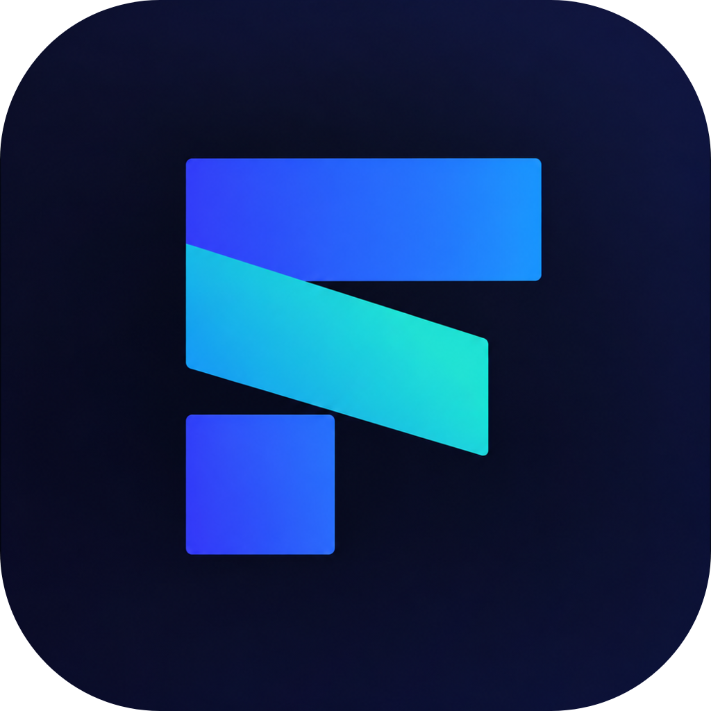
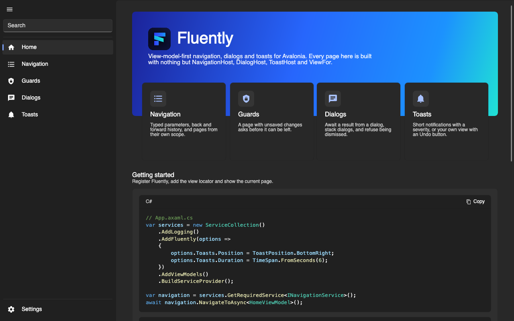
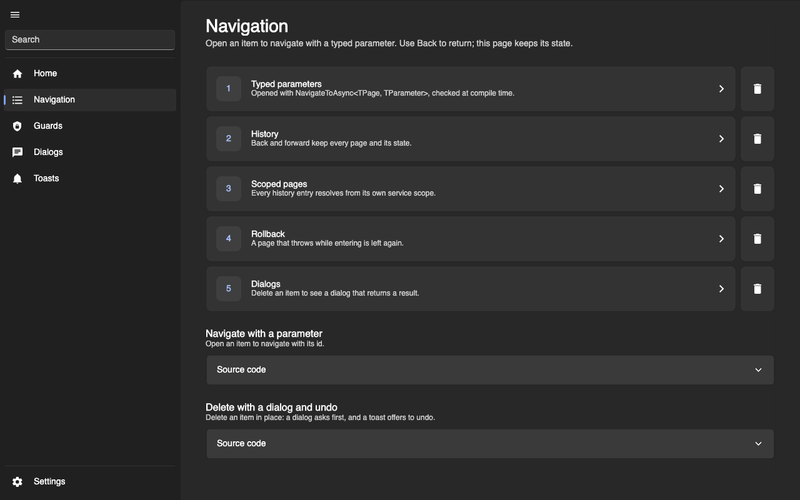
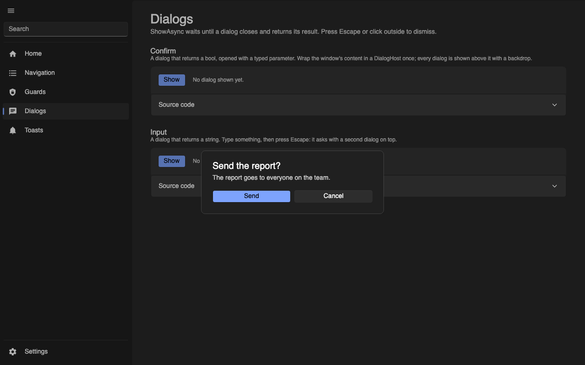
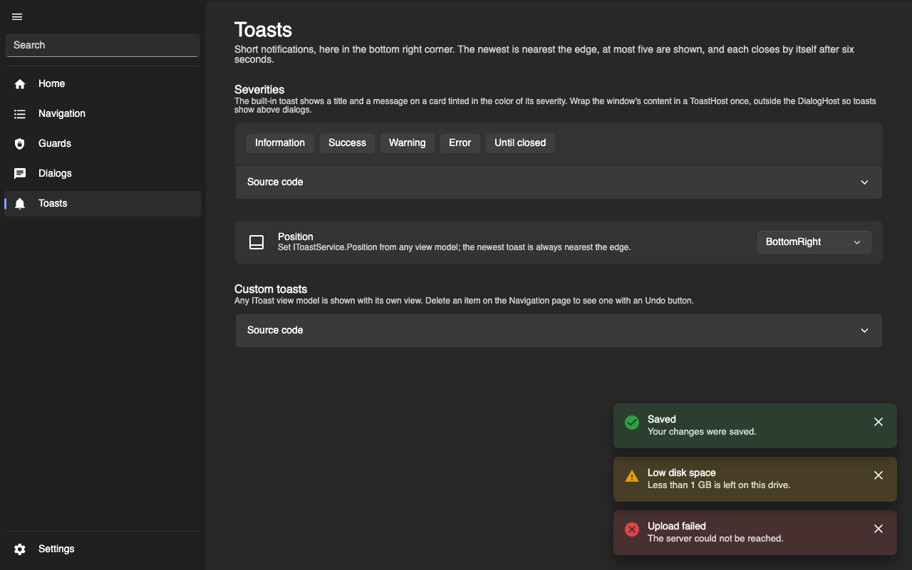
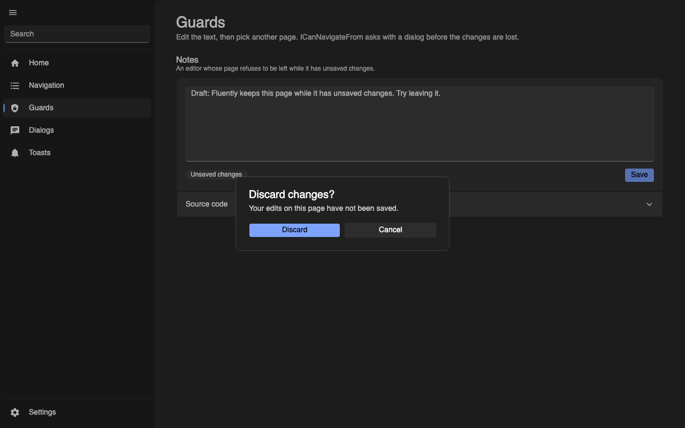

<p align="center">
    
</p>

# Fluently

[](https://github.com/taner04/Fluently/actions/workflows/ci.yml)
[](https://www.nuget.org/packages/Fluently.Core)
[](https://www.nuget.org/packages/Fluently.Avalonia)
[](LICENSE)

Fluently is a view-model-first toolkit for .NET desktop apps. You navigate to view models, show dialogs that return a
result, and show toasts, all from your view models and without touching a view. For Avalonia, it adds the window of a
Windows 11 app: content that reaches into the title bar, a back button, and a navigation pane that follows your
navigation.

<p align="center">
    
</p>

| Navigation | Dialogs |
|---|---|
|  |  |
| **Toasts** | **Guards** |
|  |  |

_Screenshots of the [gallery](src/Fluently.Gallery), styled with FluentAvalonia._

## Features

**Navigation**

- Navigate to a view model type; the view is found for you
- Typed parameters, checked at compile time: `NavigateToAsync<ChatViewModel, ChatId>(chatId)`
- Back and forward history, bindable `CanGoBack` and `CanGoForward`, and `ClearHistoryAsync` after signing in or out
- Guards: a page with unsaved changes can refuse to be left, and ask with a dialog first
- Rollback: when entering a page fails, the previous page comes back
- Every page gets its own service scope, disposed when it leaves the history
- Async, cancelable and serialized: overlapping navigations run one after another

**Dialogs and toasts**

- `await dialogs.ShowAsync<ConfirmViewModel, bool>()` returns what the dialog was closed with
- Dialogs stack, get their own scope, and can refuse being dismissed
- Toasts with a title, message and severity, or with a view of your own, such as one with an Undo button
- Toast position, duration and count are configurable, and toasts can be shown from any thread

**Avalonia**

- `NavigationHost`, `DialogHost` and `ToastHost` show pages, dialogs and toasts, with Fluent motion
- `FluentWindow` extends your content into the title bar, with Mica on Windows 11
- `TitleBar` with a back button, your icon and the window title, and back and forward on the mouse's side buttons
- `NavigationPane` with items, footer items, a collapsible pane, search with Ctrl+L, and selection that follows navigation
- No theme of its own: everything takes the look of your theme, such as FluentAvalonia's

**Tooling**

- Views and view models are registered by a source generator: no registration code, no reflection, ready for trimming
  and Native AOT
- Mistakes such as a view without a constructor for its view model are compiler errors
- Every public type and member is documented, so your editor explains it while you type

## Packages

| Package | Use it for |
|---|---|
| [`Fluently.Core`](src/Fluently.Core/README.md) | View model projects: navigation, dialogs, toasts and view registration, without any UI dependency. |
| [`Fluently.Avalonia`](src/Fluently.Avalonia/README.md) | Avalonia apps: the view locator, the hosts, `ViewFor<TViewModel>`, `FluentWindow`, `TitleBar` and `NavigationPane`. Brings `Fluently.Core` with it. |

The [source generators](src/Fluently.SourceGenerator/README.md) ship inside `Fluently.Core`. Both packages target
.NET 8 and .NET 10; `Fluently.Avalonia` needs Avalonia 12.1 or later.

## Quick start

An Avalonia app with a window, a navigation pane and two pages.

```bash
dotnet add package Fluently.Avalonia
```

**1. Write your pages and their views.** The attribute says how long a page lives; the view is registered by the
source generator.

```csharp
[SingletonPage]
public sealed class HomeViewModel : INavigableViewModel;

[TransientPage]
public sealed class SettingsViewModel : INavigableViewModel;

internal partial class HomeView : ViewFor<HomeViewModel>
{
    public HomeView(HomeViewModel viewModel) : base(viewModel) => InitializeComponent();
}

internal partial class SettingsView : ViewFor<SettingsViewModel>
{
    public SettingsView(SettingsViewModel viewModel) : base(viewModel) => InitializeComponent();
}
```

**2. Give the window its services.**

```csharp
public sealed class MainWindowViewModel(INavigationService navigation, IDialogService dialogs, IToastService toasts)
{
    public INavigationService Navigation { get; } = navigation;

    public IDialogService Dialogs { get; } = dialogs;

    public IToastService Toasts { get; } = toasts;
}
```

**3. Register Fluently and show the first page.**

```csharp
public override async void OnFrameworkInitializationCompleted()
{
    if (ApplicationLifetime is IClassicDesktopStyleApplicationLifetime desktop)
    {
        var services = new ServiceCollection()
            .AddLogging()
            .AddFluently()
            .AddViewModels()
            .AddSingleton<MainWindowViewModel>()
            .BuildServiceProvider();

        desktop.MainWindow = new MainWindow { DataContext = services.GetRequiredService<MainWindowViewModel>() };
        await services.GetRequiredService<INavigationService>().NavigateToAsync<HomeViewModel>();
    }

    base.OnFrameworkInitializationCompleted();
}
```

**4. Build the window.**

```xml
<fluently:FluentWindow xmlns="https://github.com/avaloniaui"
                       xmlns:x="http://schemas.microsoft.com/winfx/2006/xaml"
                       xmlns:fluently="https://github.com/taner04/fluently"
                       xmlns:vm="using:MyApp.ViewModels"
                       x:Class="MyApp.MainWindow"
                       x:DataType="vm:MainWindowViewModel"
                       Title="My App"
                       Navigation="{Binding Navigation}">
    <fluently:ToastHost Toasts="{Binding Toasts}">
        <fluently:DialogHost Dialogs="{Binding Dialogs}">
            <Grid RowDefinitions="Auto,*">
                <fluently:TitleBar />
                <fluently:NavigationPane Grid.Row="1"
                                         IsBackButtonVisible="False" IsSearchVisible="True">
                    <fluently:NavigationPane.Items>
                        <fluently:NavigationPaneItem Title="Home" Icon="{StaticResource HomeIcon}"
                                                     Page="{x:Type vm:HomeViewModel}" />
                    </fluently:NavigationPane.Items>
                    <fluently:NavigationPane.FooterItems>
                        <fluently:NavigationPaneItem Title="Settings" Icon="{StaticResource SettingsIcon}"
                                                     Page="{x:Type vm:SettingsViewModel}" />
                    </fluently:NavigationPane.FooterItems>
                    <fluently:NavigationHost Navigation="{Binding Navigation}" />
                </fluently:NavigationPane>
            </Grid>
        </fluently:DialogHost>
    </fluently:ToastHost>
</fluently:FluentWindow>
```

```csharp
public partial class MainWindow : FluentWindow
{
    public MainWindow() => InitializeComponent();
}
```

`HomeIcon` and `SettingsIcon` are `StreamGeometry` resources of your app; an icon can also be any control, such as one
from an icon font.

From any view model, navigate, ask and tell:

```csharp
await navigation.NavigateToAsync<SettingsViewModel>();

var result = await dialogs.ShowAsync<ConfirmDeleteViewModel, bool, string>(item.Name);
if (result is { IsCompleted: true, Value: true })
{
    toasts.ShowSuccess("Deleted", $"{item.Name} was deleted.");
}
```

## Documentation

| Read | For |
|---|---|
| [`Fluently.Core`](src/Fluently.Core/README.md) | Registration and options, pages and their lifecycle, navigation and its behavior, dialogs, toasts, views |
| [`Fluently.Avalonia`](src/Fluently.Avalonia/README.md) | Views and the view locator, the hosts, the built-in toast, `FluentWindow`, `TitleBar`, `NavigationPane`, using it with FluentAvalonia |
| [`Fluently.SourceGenerator`](src/Fluently.SourceGenerator/README.md) | The registration attributes, the generated code, and the compiler errors `FLUENTLY001` to `FLUENTLY007` |
| [Changelog](CHANGELOG.md) | What changed in every release |

## Gallery

[`src/Fluently.Gallery`](src/Fluently.Gallery) is a gallery app in the style of [WPF UI](https://github.com/lepoco/wpfui)'s.
Every page shows one part of Fluently with live examples and their C# and XAML: navigation with parameters, guards,
dialogs, toasts and their positions, and a settings page that switches the theme. It is styled with the theme of
[FluentAvalonia](https://github.com/amwx/FluentAvalonia); its window, title bar, navigation pane, dialogs and toasts are
Fluently's.

```bash
dotnet run --project src/Fluently.Gallery
```

## Building from source

```bash
dotnet build Fluently.slnx
dotnet test --solution Fluently.slnx
```

| Folder | Contains |
|---|---|
| `src/Fluently.Core` | The core package |
| `src/Fluently.Avalonia` | The Avalonia package |
| `src/Fluently.SourceGenerator` | The source generators, packed into `Fluently.Core` |
| `src/Fluently.Gallery` | The gallery app |
| `tests` | Unit tests for each project; the Avalonia tests run headless |

The tests run on .NET 8 and .NET 10, so both SDKs or runtimes need to be installed. Releases are published to NuGet from
GitHub Actions when a `v*` tag is pushed; the version comes from the tag.

## Inspiration

Fluently is inspired by [WPF UI](https://github.com/lepoco/wpfui) by lepoco. I work with Avalonia, and I really liked
how WPF UI handles navigation and its gallery app, so I wanted something like it for Avalonia as well.

## License

Fluently is licensed under the [MIT License](LICENSE).
